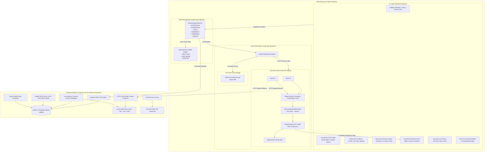

# Pulse — System Architecture & Specification

## 1. System Architecture & Data-Flow Diagram



---

## 2. Complete SQLite Database Schema

```sql
-- 1. Tracks Table
CREATE TABLE IF NOT EXISTS tracks (
    id TEXT PRIMARY KEY,
    title TEXT NOT NULL,
    artist TEXT NOT NULL,
    album TEXT,
    duration_seconds REAL NOT NULL DEFAULT 0,
    source_type TEXT CHECK(source_type IN ('local', 'stream', 'youtube')) NOT NULL,
    source_url TEXT,
    local_path TEXT,
    youtube_video_id TEXT,
    cover_art_url TEXT,
    bpm REAL,
    energy REAL CHECK(energy >= 0.0 AND energy <= 1.0),
    key_signature TEXT,
    genre TEXT,
    isrc TEXT,
    bitrate INTEGER,
    play_count INTEGER NOT NULL DEFAULT 0,
    skip_count INTEGER NOT NULL DEFAULT 0,
    last_played_at DATETIME,
    created_at DATETIME NOT NULL DEFAULT CURRENT_TIMESTAMP,
    updated_at DATETIME NOT NULL DEFAULT CURRENT_TIMESTAMP
);

CREATE INDEX IF NOT EXISTS idx_tracks_artist ON tracks(artist);
CREATE INDEX IF NOT EXISTS idx_tracks_source ON tracks(source_type);
CREATE INDEX IF NOT EXISTS idx_tracks_genre ON tracks(genre);
CREATE INDEX IF NOT EXISTS idx_tracks_bpm ON tracks(bpm);

-- 2. Playlists Table
CREATE TABLE IF NOT EXISTS playlists (
    id TEXT PRIMARY KEY,
    name TEXT NOT NULL,
    description TEXT,
    is_smart INTEGER NOT NULL DEFAULT 0,
    cover_url TEXT,
    is_favorite INTEGER NOT NULL DEFAULT 0,
    created_at DATETIME NOT NULL DEFAULT CURRENT_TIMESTAMP,
    updated_at DATETIME NOT NULL DEFAULT CURRENT_TIMESTAMP
);

-- 3. Playlist Tracks Table (Ordered Join)
CREATE TABLE IF NOT EXISTS playlist_tracks (
    id TEXT PRIMARY KEY,
    playlist_id TEXT NOT NULL REFERENCES playlists(id) ON DELETE CASCADE,
    track_id TEXT NOT NULL REFERENCES tracks(id) ON DELETE CASCADE,
    position INTEGER NOT NULL,
    added_at DATETIME NOT NULL DEFAULT CURRENT_TIMESTAMP,
    UNIQUE(playlist_id, position)
);

CREATE INDEX IF NOT EXISTS idx_playlist_tracks_playlist ON playlist_tracks(playlist_id);

-- 4. Smart Playlist Rules Table
CREATE TABLE IF NOT EXISTS smart_playlist_rules (
    id TEXT PRIMARY KEY,
    playlist_id TEXT NOT NULL REFERENCES playlists(id) ON DELETE CASCADE,
    field TEXT NOT NULL,          -- 'genre', 'artist', 'bpm', 'energy', 'play_count', 'skip_count', 'last_played_days'
    operator TEXT NOT NULL,       -- 'equals', 'contains', 'greater_than', 'less_than', 'between'
    value TEXT NOT NULL,          -- Scalar string/number or JSON array
    logic_gate TEXT NOT NULL DEFAULT 'AND' CHECK(logic_gate IN ('AND', 'OR'))
);

CREATE INDEX IF NOT EXISTS idx_smart_rules_playlist ON smart_playlist_rules(playlist_id);

-- 5. Queue Snapshots Table
CREATE TABLE IF NOT EXISTS queue_snapshots (
    id TEXT PRIMARY KEY,
    name TEXT NOT NULL,
    priority_queue_json TEXT NOT NULL,  -- JSON Array of Track objects
    context_queue_json TEXT NOT NULL,   -- JSON Array of Track objects
    current_track_id TEXT REFERENCES tracks(id) ON DELETE SET NULL,
    current_playback_time REAL NOT NULL DEFAULT 0,
    shuffle_mode TEXT NOT NULL DEFAULT 'off',
    created_at DATETIME NOT NULL DEFAULT CURRENT_TIMESTAMP
);

-- 6. EQ Presets Table
CREATE TABLE IF NOT EXISTS eq_presets (
    id TEXT PRIMARY KEY,
    name TEXT NOT NULL UNIQUE,
    is_default INTEGER NOT NULL DEFAULT 0,
    preamp_gain REAL NOT NULL DEFAULT 0.0,
    band_gains_json TEXT NOT NULL,      -- Array of 10 float values in dB (-12 to +12)
    created_at DATETIME NOT NULL DEFAULT CURRENT_TIMESTAMP
);

-- 7. Play History Table
CREATE TABLE IF NOT EXISTS play_history (
    id TEXT PRIMARY KEY,
    track_id TEXT NOT NULL REFERENCES tracks(id) ON DELETE CASCADE,
    played_at DATETIME NOT NULL DEFAULT CURRENT_TIMESTAMP,
    duration_played_seconds REAL NOT NULL DEFAULT 0,
    completed INTEGER NOT NULL DEFAULT 0,
    context_type TEXT CHECK(context_type IN ('playlist', 'album', 'search', 'manual')),
    context_id TEXT
);

CREATE INDEX IF NOT EXISTS idx_play_history_track ON play_history(track_id);
CREATE INDEX IF NOT EXISTS idx_play_history_played_at ON play_history(played_at);
```

---

## 3. Explicit REST API Contracts

### Base URL: `/api`

#### 1. Tracks API
- `GET /api/tracks`
  - Query parameters: `q` (string), `genre` (string), `artist` (string), `source` (string), `limit` (number), `offset` (number).
  - Response 200: `{ "tracks": Track[], "total": number }`
- `GET /api/tracks/:id`
  - Response 200: `Track` | Response 404: `{ "error": "Not Found" }`
- `POST /api/tracks`
  - Body: `CreateTrackDTO`
  - Response 201: `Track`
- `POST /api/tracks/:id/telemetry`
  - Body: `{ "durationPlayed": number, "completed": boolean, "contextType"?: string, "contextId"?: string }`
  - Response 200: `{ "success": true, "playCount": number, "skipCount": number }`

#### 2. Streaming & Audio Files
- `GET /api/stream/:id`
  - Handles HTTP `Range: bytes=start-end` requests.
  - Response 206 Partial Content with headers:
    - `Content-Range: bytes <start>-<end>/<total>`
    - `Accept-Ranges: bytes`
    - `Content-Length: <chunk-size>`
    - `Content-Type: audio/mpeg` (or respective mime-type)
- `POST /api/library/scan`
  - Body: `{ "directoryPath"?: string }`
  - Response 200: `{ "scanned": number, "added": number, "updated": number }`

#### 3. Playlists & Smart Rules
- `GET /api/playlists`
  - Response 200: `PlaylistSummary[]`
- `POST /api/playlists`
  - Body: `{ "name": string, "description"?: string, "isSmart"?: boolean, "rules"?: SmartRuleDTO[] }`
  - Response 201: `Playlist`
- `GET /api/playlists/:id`
  - Response 200: `PlaylistWithTracks`
- `PUT /api/playlists/:id`
  - Body: `{ "name"?: string, "description"?: string, "isFavorite"?: boolean }`
  - Response 200: `Playlist`
- `DELETE /api/playlists/:id`
  - Response 200: `{ "success": true }`
- `POST /api/playlists/:id/tracks`
  - Body: `{ "trackId": string, "position"?: number }`
  - Response 201: `{ "success": true, "trackCount": number }`
- `DELETE /api/playlists/:id/tracks/:trackId`
  - Response 200: `{ "success": true }`
- `PUT /api/playlists/:id/reorder`
  - Body: `{ "trackIds": string[] }`
  - Response 200: `{ "success": true }`
- `GET /api/playlists/:id/smart-resolve`
  - Resolves dynamic smart playlist rules into current matching tracks.
  - Response 200: `{ "tracks": Track[], "total": number }`

#### 4. Queue Snapshots
- `GET /api/queue-snapshots`
  - Response 200: `QueueSnapshot[]`
- `POST /api/queue-snapshots`
  - Body: `{ "name": string, "priorityQueue": Track[], "contextQueue": Track[], "currentTrackId"?: string, "currentPlaybackTime": number, "shuffleMode": string }`
  - Response 201: `QueueSnapshot`
- `DELETE /api/queue-snapshots/:id`
  - Response 200: `{ "success": true }`

#### 5. Equalizer Presets
- `GET /api/eq-presets`
  - Response 200: `EQPreset[]`
- `POST /api/eq-presets`
  - Body: `{ "name": string, "preampGain": number, "bandGains": number[] }`
  - Response 201: `EQPreset`
- `DELETE /api/eq-presets/:id`
  - Response 200: `{ "success": true }`

#### 6. Spotify Import & Demo Seed
- `POST /api/spotify/seed-demo`
  - Seeds 50+ deterministic realistic tracks across Rock, Synthwave, Classical, Jazz, Lo-Fi, Metal, Pop, and Electronic with audio previews, lyrics metadata, and YouTube fallback IDs.
  - Response 200: `{ "success": true, "seeded": number, "playlistCount": number }`
- `GET /api/spotify/auth-url`
  - Response 200: `{ "url": string, "codeVerifier": string }`
- `POST /api/spotify/callback`
  - Body: `{ "code": string, "codeVerifier": string }`
  - Response 200: `{ "accessToken": string, "profile": any }`
- `POST /api/spotify/import-playlist`
  - Body: `{ "playlistId": string, "accessToken": string }`
  - Response 200: `{ "imported": number, "playlist": Playlist }`

#### 7. Synchronized Lyrics (LRCLIB Proxy)
- `GET /api/lyrics`
  - Query parameters: `track_name` (string), `artist_name` (string), `album_name` (string), `duration` (number).
  - Response 200: `{ "syncedLyrics": string, "plainLyrics": string, "instrumental": boolean }`

---

## 4. Strict File Ownership Boundaries

| Subagent | Exclusive Ownership | Non-Interference Guarantee |
| :--- | :--- | :--- |
| **backend-engineer** | `backend/` | Never touches `frontend/` files. Exposes HTTP REST API and WebSocket/SSE if needed. |
| **audio-dsp-engineer**| `frontend/src/audio/`, `frontend/src/store/playerStore.ts` | Owns audio engine, DSP graph, dual-deck crossfader, YouTube bridge, shuffle logic, and queue store state. |
| **frontend-engineer** | `frontend/src/components/`, `frontend/src/pages/`, `frontend/src/styles/`, `frontend/index.html` | Consumes `playerStore.ts` and backend API without modifying DSP internals. |
| **qa-engineer** | `backend/tests/`, `frontend/src/__tests__/`, test scripts | Verifies and tests without altering production logic without authorization. |

---

## 5. Non-Overlapping Subagent Task Checklists

### Systems Architect (`architect`)
- [x] Create system architecture diagram and data-flow specifications.
- [x] Define SQLite database schema with indexes and cascading relations.
- [x] Define explicit REST API routes and TypeScript contracts.
- [x] Specify engineer checklist and file boundaries.

### Backend & Sync Engineer (`backend-engineer`)
- [x] Initialize Node.js/Express + TypeScript backend project in `backend/`.
- [x] Implement SQLite schema and `better-sqlite3` database driver in `backend/src/db/`.
- [x] Implement deterministic 50+ track demo seed in `backend/src/db/seed.ts` with audio previews.
- [x] Implement HTTP `206 Partial Content` audio streaming controller in `backend/src/routes/stream.ts`.
- [x] Implement local folder scanner in `backend/src/services/scanner.ts`.
- [x] Implement Spotify PKCE OAuth2 and playlist importer in `backend/src/services/spotify.ts`.
- [x] Implement Full-Length Spotify Playlist Scraper with Pathfinder GraphQL pagination in `backend/src/services/spotifyScraper.ts` (resolves playlists >100 tracks without truncation or API keys).
- [x] Implement Smart Playlist rule evaluator in `backend/src/services/smartPlaylistEvaluator.ts`.
- [x] Implement LRCLIB lyrics proxy in `backend/src/routes/lyrics.ts`.
- [x] Implement CRUD routes for tracks, playlists, queue snapshots, and EQ presets.

### Audio DSP & Playback Engineer (`audio-dsp-engineer`)
- [x] Implement Web Audio API dual-deck audio engine in `frontend/src/audio/AudioGraph.ts`.
- [x] Implement 10-band parametric equalizer with BiquadFilterNode cascaded filters.
- [x] Implement equal-power dual-deck crossfader (0s-12s) in `frontend/src/audio/Crossfader.ts`.
- [x] Implement AnalyserNode frequency and waveform provider in `frontend/src/audio/VisualizerSource.ts`.
- [x] Implement YouTube IFrame Player API adapter in `frontend/src/audio/YouTubeBridge.ts`.
- [x] Implement unified `PlaybackController.ts` handling seamless source switching and A-B looping.
- [x] Implement three deterministic shuffle algorithms in `frontend/src/audio/shuffle.ts` (Fisher-Yates, Artist-Spread, BPM Flow).
- [x] Implement dual-layer queue Zustand store in `frontend/src/store/playerStore.ts`.
- [x] Implement Concurrency Guard with generation request sequencing (`currentRequestId`), cancelable crossfade, and 0ms optimistic UI updates in `PlaybackController.ts` and `playerStore.ts`.

### Frontend & UX Engineer (`frontend-engineer`)
- [x] Initialize Vite + React 19 + TypeScript + Tailwind CSS in `frontend/`.
- [x] Build Dark Glassmorphic layout with responsive sidebar and header.
- [x] Build Virtualized Track Table with multi-select, sortable headers, and context menu.
- [x] Build Player Bar with frame-accurate scrubber, A-B loop handles, speed selector, and volume slider.
- [x] Build Dual-Layer Queue Drawer with visual Priority vs Context separation and drag-and-drop reordering.
- [x] Build 10-Band Parametric EQ Drawer with frequency sliders, preset selector, and 60fps Canvas Visualizer.
- [x] Build Synchronized Lyrics Panel with LRCLIB timestamp sync, auto-scroll, and click-to-seek.
- [x] Build Smart Playlist Rule Builder modal with dynamic criteria filters.
- [x] Build Global Command Palette (`Cmd+K`) and keyboard shortcuts (Space, J, K, N, P, S, L, E).

### QA & Browser Verifier (`qa-engineer`)
- [x] Write and run backend tests (`backend/tests/`):
  - [x] Test HTTP 206 Partial Content byte-range audio streaming.
  - [x] Test 50-track demo seed verification.
  - [x] Test Smart Playlist SQL filter evaluator.
  - [x] Test Queue snapshot persistence and retrieval.
- [x] Write and run frontend unit tests (`frontend/src/__tests__/`):
  - [x] Test dual-layer queue ordering (Priority Queue plays before Context Queue).
  - [x] Test Fisher-Yates shuffle cycle exhaustiveness (zero repeats).
  - [x] Test Artist-Spread shuffle spacing invariant.
  - [x] Test A-B loop boundary clamping and timeline scrubbing.
- [x] Verify production build (`npm run build`) with zero TypeScript errors.
- [x] Execute live browser verification on running backend and frontend servers:
  - [x] Verify track playback and timeline scrubbing.
  - [x] Verify dual-layer queue drag-and-drop reordering.
  - [x] Verify 10-band EQ preset toggle and visualizer animation.
  - [x] Verify synchronized lyrics rendering.
  - [x] Verify smart playlist creation.
