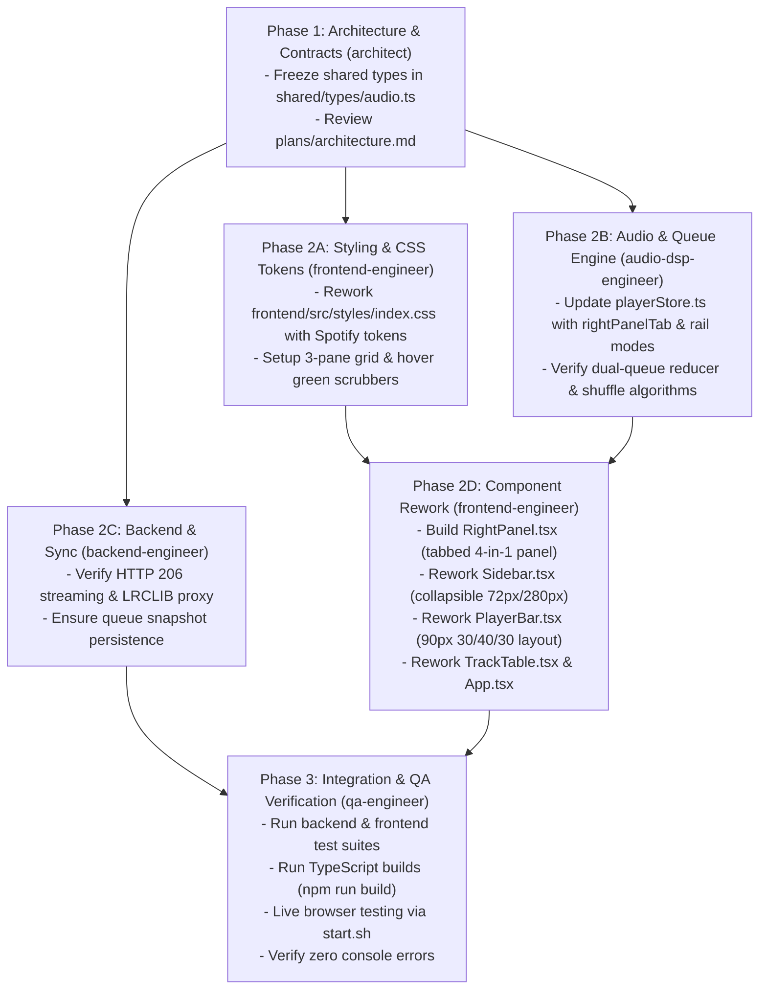

# Pulse Personal Music Workstation: Spotify "xpui" Clone Rework Plan

**Architecture Standard:** Exact Spotify desktop (`xpui`) 3-pane layout, design tokens, and state flow enhanced with Pulse's unrestricted workstation audio engine.  
**Reverse Engineering Evidence:** `plans/rea-spotify-evidence.md` & `plans/rea-evidence-bundle.json` (`morluto/rea`)  
**File-Ownership Boundaries:** Strictly aligned with `.agents/rules/multi-agent-workflow.md`

---

## 1. Executive Summary & Design Vision

Pulse is being transformed from a generic dark UI into an **exact Spotify ("xpui") desktop workstation clone** while maintaining our custom playback enhancements:
1. **Spotify xpui 3-Pane Layout Geometry:**
   - **Outer Canvas:** `#000000` pitch black background with `8px` gap between panels.
   - **Left Rail ("Your Library"):** Collapsible rail (`72px` icon-only mode <-> `280px-420px` resizable list) with filter chips ("Playlists", "Artists", "Albums"), search within library, and `+` playlist creator.
   - **Center Viewport ("Main View"):** Dynamic-gradient ambient hero section based on active cover art, sticky 64px header with navigation buttons, universal search pill, and virtualized track table.
   - **Right Context Rail ("Panel Section"):** Seamless `340px` tabbed panel hosting **Now Playing View**, **Dual Queue (Priority + Context)**, **10-Band Parametric EQ & 60fps Visualizer**, and **Synced Lyrics**.
   - **Bottom Transport Bar:** Fixed `90px` bottom dock spanning all 3 columns with exact 30% / 40% / 30% flex segments, Spotify green hover scrubber, and dot indicator buttons.
2. **Pulse Unrestricted Features:**
   - **Unlimited Skips & Unlocked Scrubbing:** No skip limits, no forced shuffle, instant HTTP `206 Partial Content` timeline seeking.
   - **Dual-Layer Queue Engine:** Priority Queue ("Play Next" user queue) + Context Queue (active playlist/album) with drag-and-drop reordering and 1-click SQLite Queue Snapshots.
   - **3 Deterministic Shuffle Algorithms:** Pure Fisher-Yates (zero repeats per cycle), Artist-Spread (prevents clustering), and BPM/Energy Flow (tempo harmonic progression).
   - **10-Band Web Audio API EQ + 60fps Visualizer:** 31Hz - 16kHz `BiquadFilterNode` cascade, preamp gain, presets, and real-time canvas frequency spectrum.
   - **Dual-Deck Crossfader:** 0s-12s equal-power crossfading between consecutive tracks.
   - **A-B Loop Section Player:** Precision loop markers with start/end bounds for studying solos, transcribing, or repeating sections.
   - **Smart Playlists & Synced Lyrics:** Dynamic SQL rule evaluator (BPM, genre, energy, plays) and LRCLIB synchronized lyrics proxy with click-to-seek.

---

## 2. File-by-File Rework Mapping

### 2.1 Shared Types Layer (`architect` Exclusive Ownership)
*Directory: `shared/types/`*

#### `shared/types/audio.ts`
- **Current State:** Contains definitions for `Track`, `Playlist`, `QueueSnapshot`, `EQPreset`, `ShuffleMode`, `RepeatMode`, `ABLoopMarker`, `SmartPlaylistRule`.
- **Rework Required:**
  - Add Spotify UI view types:
    ```typescript
    export type RightPanelTab = 'now-playing' | 'queue' | 'eq' | 'lyrics' | null;
    export type LeftRailMode = 'expanded' | 'collapsed';
    export type LibraryFilter = 'all' | 'playlists' | 'artists' | 'albums';
    export type LibrarySort = 'recents' | 'recently_added' | 'alphabetical' | 'creator';
    ```
  - Ensure `Track` interface includes audio telemetry fields (`bpm`, `energy`, `keySignature`, `isFavorite`, `sourceType`, `durationSeconds`).
  - Export unified types consumed by both `frontend/` and `backend/`.

---

### 2.2 Styling & Design System (`frontend-engineer` Exclusive Ownership)
*Directory: `frontend/src/styles/`*

#### `frontend/src/styles/index.css`
- **Current State:** Uses Tailwind v4 with generic Slate/Indigo theme variables.
- **Rework Required:**
  - Replace Slate palette with Spotify's extracted production design tokens:
    ```css
    :root {
      /* Background Canvas */
      --spotify-black: #000000;
      --background-base: #121212;
      --background-highlight: #1a1a1a;
      --background-press: #000000;
      --background-elevated-base: #181818;
      --background-elevated-highlight: #282828;
      --background-elevated-press: #242424;
      --background-tinted-base: rgba(255, 255, 255, 0.07);
      --background-tinted-highlight: rgba(255, 255, 255, 0.1);

      /* Primary Green */
      --essential-positive: #1db954;
      --essential-bright-accent: #1ed760;
      --spotify-green: #1db954;
      --spotify-green-hover: #1ed760;

      /* Text */
      --text-base: #ffffff;
      --text-subdued: #a7a7a7;
      --text-subdued-dim: #b3b3b3;
      --text-bright-accent: #1ed760;

      /* Geometry */
      --panel-gap: 8px;
      --panel-radius: 8px;
      --pill-radius: 500px;
      --button-radius: 500px;

      /* Typography */
      --font-family: CircularSp, -apple-system, BlinkMacSystemFont, "Segoe UI", Roboto, Helvetica, Arial, sans-serif;
    }
    ```
  - Define root grid layout class `.spotify-xpui-container`:
    ```css
    .spotify-xpui-container {
      display: grid;
      width: 100vw;
      height: 100vh;
      padding: var(--panel-gap);
      gap: var(--panel-gap);
      background-color: var(--spotify-black);
      grid-template-rows: 1fr 90px;
      grid-template-columns: var(--left-sidebar-width, 280px) 1fr var(--right-sidebar-width, 340px);
      grid-template-areas:
        "left-sidebar main-view right-sidebar"
        "now-playing-bar now-playing-bar now-playing-bar";
      overflow: hidden;
    }
    ```
  - Implement Spotify Scrubber Slider styles:
    - Normal state: 4px height, `#4d4d4d` track, `#ffffff` progress bar, thumb invisible.
    - Hover/drag state: 6px height, progress bar turns `#1DB954`, 12px white circular thumb appears.
  - Implement Spotify Card hover transitions, scrollbar styling (`6px` width, `#ffffff4d` thumb), and active green dot indicator.

---

### 2.3 Audio DSP & Playback Engine (`audio-dsp-engineer` Exclusive Ownership)
*Directory: `frontend/src/audio/` and `frontend/src/store/`*

#### `frontend/src/store/playerStore.ts`
- **Current State:** Zustand store implementing dual queue, shuffle, loop, EQ, and controller hooks.
- **Rework Required:**
  - Connect UI panel state directly into the store or dedicated layout slice:
    - `rightPanelTab: RightPanelTab` (`'now-playing' | 'queue' | 'eq' | 'lyrics' | null`).
    - `leftRailMode: LeftRailMode` (`'expanded' | 'collapsed'`).
    - `leftRailWidth: number` (default `280`, bounds `230`-`420`).
    - `rightRailWidth: number` (default `340`, bounds `280`-`420`).
    - Actions: `setRightPanelTab(tab)`, `toggleRightPanelTab(tab)`, `setLeftRailMode(mode)`, `setLeftRailWidth(w)`, `setRightRailWidth(w)`.
  - Maintain queue reducer invariants:
    - `addToPriorityQueue(track, position)`: adds to priority queue with instantaneous telemetry.
    - `reorderPriorityQueue(fromIndex, toIndex)`: drag-and-drop support.
    - `reorderContextQueue(fromIndex, toIndex)`: context queue reordering.
    - `skipToNext()`: priority queue first, then context queue, honoring repeat/shuffle.
    - `skipToPrevious()`: if >3s seek to 0, else pop history.

#### `frontend/src/audio/AudioGraph.ts`
- **Current State:** 10-band `BiquadFilterNode` cascade connected to `AnalyserNode` and `GainNode`.
- **Rework Required:**
  - Verify band frequencies match ISO standards: 31Hz, 62Hz, 125Hz, 250Hz, 500Hz, 1kHz, 2kHz, 4kHz, 8kHz, 16kHz.
  - Export real-time frequency analysis helper `getByteFrequencyData(array: Uint8Array)`.

#### `frontend/src/audio/Crossfader.ts`
- **Current State:** Dual-deck crossfader utilizing equal-power sine/cosine gain curves.
- **Rework Required:**
  - Support configurable 0s-12s crossfade duration with zero audible clipping.

#### `frontend/src/audio/shuffle.ts`
- **Current State:** Implements Fisher-Yates, Artist-Spread, and BPM-Flow.
- **Rework Required:**
  - Keep test coverage verifying deterministic seed completion and zero premature repeats.

---

### 2.4 Frontend UX & Components (`frontend-engineer` Exclusive Ownership)
*Directory: `frontend/src/components/`, `frontend/src/App.tsx`*

#### `frontend/src/App.tsx`
- **Current State:** Column flex layout with conditional popovers.
- **Rework Required:**
  - Replace layout with the 3-pane CSS grid `.spotify-xpui-container`:
    1. `<Sidebar />` in `left-sidebar` grid area.
    2. `<MainView />` in `main-view` grid area.
    3. `<RightPanel />` in `right-sidebar` grid area (conditionally renders if `rightPanelTab !== null`).
    4. `<PlayerBar />` in `now-playing-bar` grid area.
  - Mount global modals: `SmartPlaylistModal`, `SpotifySearchModal`, `ImportSpotifyPlaylistModal`, `AddSongsModal`, `CommandPalette`.

#### `frontend/src/components/Sidebar.tsx` ("Your Library" Rail)
- **Current State:** Desktop sidebar + mobile slide-out drawer.
- **Rework Required:**
  - Support two desktop rendering modes:
    - **Collapsed Mode (72px):** Library icon with tooltip, collapsed playlist avatar icons with hover labels.
    - **Expanded Mode (280px-420px):**
      - Top section: "Home" & "Search" nav links.
      - "Your Library" header with `Library` icon, "+ New" dropdown (Regular Playlist, Smart Playlist, Scan Library), and Collapse `<->` toggle.
      - Filter pills: "Playlists", "Artists", "Albums".
      - Search input filter + Sort dropdown (Recents, Added, Alphabetical).
      - Virtualized playlist rows with 48x48 cover art, title, subtitle (`Playlist • X tracks`), and playing equalizer animation icon when active.
  - Right draggable splitter edge with `col-resize` cursor to resize sidebar width.

#### `frontend/src/components/PlayerBar.tsx` (Bottom 90px Transport Bar)
- **Current State:** Custom player bar with audio controls.
- **Rework Required:**
  - Implement exact 3-segment flex geometry (`30%` / `40%` / `30%`):
    - **Left (30%, min 180px):**
      - 56x56 cover art thumbnail with hover expand icon.
      - Track title (`#ffffff`, 14px, bold) & Artist name (`#a7a7a7`, 12px, hover underline).
      - Like button (Heart icon, green `#1DB954` when liked).
      - Picture-in-Picture / Mini-player toggle.
    - **Center (40%, max 722px):**
      - Top Controls:
        - Shuffle Button: Cycles between `off`, `fisher-yates`, `artist-spread`, `bpm-flow`. Active dot indicator underneath.
        - Previous Track button.
        - Circular Play/Pause button (32px white circle `#ffffff`, black icon `#000000`, scale 1.06 on hover).
        - Next Track button.
        - Repeat Button (Off -> Repeat All -> Repeat 1 with active dot).
        - A-B Loop Button (Pulse feature): Sets Loop Start (A), Loop End (B), or clears loop.
      - Bottom Scrubber:
        - Current time (`1:24`), Scrubber track with hover green fill, Total duration (`3:45`).
    - **Right (30%, min 180px):**
      - Now Playing View toggle icon button.
      - Lyrics toggle icon button (LRCLIB sync, active green highlight).
      - Queue toggle icon button (Dual Queue, active green highlight).
      - 10-Band EQ visualizer toggle button (active green highlight).
      - Speaker icon (Mute toggle) + 96px Volume slider bar.

#### `frontend/src/components/RightPanel.tsx` (New Right Rail Container)
- **Responsibilities:** Replaces floating overlay drawers with a docked, integrated 3rd pane.
- **Components Hosted:**
  1. **Now Playing Tab:** Full album art view, large title/artist, artist bio, genre/audio stats badge (BPM, key signature, lossless/stream tag), and "Next from: [Context]" card.
  2. **Dual Queue Tab:**
     - "Now Playing" track header.
     - "Next in queue" (Priority Queue) with drag handles, delete button, and "Clear" button.
     - "Next from: [Playlist Name]" (Context Queue) with drag handles and "Save Snapshot" button.
  3. **10-Band EQ & Visualizer Tab:**
     - 10 vertical sliders (-12dB to +12dB) across 31Hz - 16kHz.
     - Presets dropdown (Flat, Bass Boost, Vocal, Rock, Jazz, EDM, etc.).
     - Real-time 60fps Canvas spectrum visualizer.
  4. **Synced Lyrics Tab:**
     - Auto-scrolling lyrics with current line highlighted in bold white with luminous glow.
     - Click any line to seek timeline instantly.

#### `frontend/src/components/TrackTable.tsx`
- **Current State:** Track table with sortable columns.
- **Rework Required:**
  - Match Spotify's exact table aesthetics:
    - Headers: `#`, `Title`, `Album`, `Date added`, `Duration`.
    - Row hover: Subtle `#ffffff1a` background.
    - Playing track: Title in `#1DB954` / `#1ed760`, animated equalizer bars in `#` column.
    - Right-click Context Menu: "Play Next", "Add to Queue", "Add to Playlist", "Toggle Like", "Inspect Audio Metadata", "A-B Loop from Here".

---

### 2.5 Backend & Storage Layer (`backend-engineer` Exclusive Ownership)
*Directory: `backend/`*

#### `backend/src/server.ts`
- **Current State:** Express server with SQLite storage and endpoints.
- **Verified Capabilities to Maintain:**
  - `/api/tracks`: List tracks with filtering and pagination.
  - `/api/tracks/:id/stream`: HTTP `206 Partial Content` audio streaming for instant timeline scrubbing.
  - `/api/playlists`: Playlist CRUD and track association.
  - `/api/playlists/smart`: Smart playlist evaluation (BPM, energy, genre rules).
  - `/api/queue/snapshots`: Save and restore dual queue snapshots.
  - `/api/lyrics`: LRCLIB proxy for synchronized lyrics with cache.
  - `/api/spotify/seed-demo`: 50+ track multi-genre demo seed.
  - `/api/library/scan`: Local directory audio scanner.

---

### 2.6 QA, Verification & Audit Layer (`qa-engineer` Exclusive Ownership)
*Directory: `backend/tests/`, `frontend/src/__tests__/`*

#### Tasks:
1. Run backend automated tests (`npm run test` in `backend/`).
2. Run frontend unit tests (`npm run test` in `frontend/`) verifying queue reducer transitions, shuffle algorithms, and DSP graph.
3. Validate production TypeScript build (`npm run build` in `frontend/` and `backend/`).
4. Start both servers via `start.sh` and perform end-to-end browser verification:
   - Verify 3-pane layout rendering with exact Spotify `#121212` / `#000000` aesthetics.
   - Verify left rail collapse/expand and right rail tab switching (Now Playing -> Queue -> EQ -> Lyrics).
   - Verify audio playback, seeking, volume, shuffle, crossfade, and EQ visualizer at 60fps.
   - Confirm zero console errors.

---

## 3. Implementation Sequence & Execution Phasing



---

## 4. Verification Checklist & Success Criteria

- [ ] All `.agents/agents/*/agent.md` files contain `mcp_servers: [rea]`.
- [ ] Duplicate `backend 2/` removed.
- [ ] `plans/rea-spotify-evidence.md` contains all REA evidence IDs (`ev_4282e43a...`, `ev_ae1da102...`, `ev_2e58b0d4...`, `ev_602b8045...`) and extracted CSS/geometry details.
- [ ] Complete evidence bundle exported to `plans/rea-evidence-bundle.json`.
- [ ] `frontend/src/styles/index.css` implements Spotify's exact color tokens (`#000000`, `#121212`, `#181818`, `#282828`, `#1DB954`) and 3-pane grid layout.
- [ ] Left "Your Library" rail collapses cleanly to 72px and expands to 280px-420px.
- [ ] Center viewport has dynamic ambient hero gradient with sticky navigation header and virtualized track table.
- [ ] Right rail integrates Now Playing, Dual Queue (Priority + Context), 10-Band EQ + Visualizer, and Synced Lyrics in a tabbed 340px dock.
- [ ] Bottom 90px transport bar implements 30% / 40% / 30% flex segments with hover green progress bar and active dot indicators.
- [ ] Pulse unrestricted features (unlimited skips, scrubbing, A-B loop, dual queue snapshots, 3 shuffle modes, 60fps visualizer, crossfade, smart playlists) operate seamlessly.
- [ ] TypeScript builds pass with 0 errors and browser console is completely clean.
